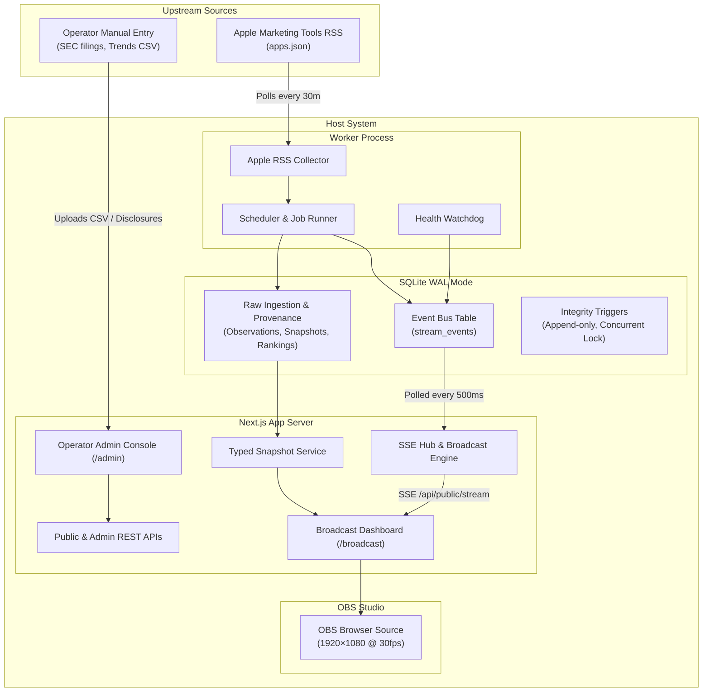
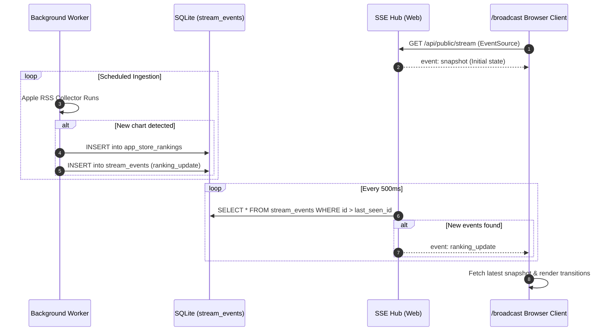

# AI Apps Live — Architecture & System Design

AI Apps Live is a local-first, broadcast-ready dashboard designed to run continuously as an OBS Studio Browser Source feeding a YouTube Live stream. It delivers high-fidelity public telemetry on major AI applications under strict truth-in-data principles.

---

## 1. High-Level Architecture

The system consists of two decoupled Node.js processes communicating through an embedded SQLite database in WAL (Write-Ahead Logging) mode:

---

## 2. Process Model & Separation of Concerns

### 2.1 The `worker` Daemon
- Runs `tsx src/worker/index.ts`.
- Single-threaded autonomous runner executing background ingestion tasks.
- Polls Apple Marketing Tools RSS with exponential backoff and jitter.
- Enforces collection floors: checks `updated` timestamp from upstream feed; avoids redundant writes if unchanged (`NO_CHANGE`).
- Records raw responses in `source_observations` before parsing into normalized `chart_snapshots` and `app_store_rankings`.
- Publishes change events into `stream_events`.

### 2.2 The `web` Process
- Runs `next start` (or `next dev` in development).
- Serves dynamic server-rendered pages and JSON APIs.
- Houses the Server-Sent Events (`/api/public/stream`) fan-out hub.
- Validates operator sessions using `node:crypto` scrypt hashes and enforces CSRF protection on state-changing operations.
- Server-renders the initial snapshot on page load for instantaneous first-frame broadcast paint.

---

## 3. Database Layer & Triggers

The database (`data/ai-apps-live.db`) runs SQLite with WAL journal mode (`PRAGMA journal_mode = WAL`) and foreign key constraints enabled.

### 3.1 Append-Only History Triggers
To prevent tampering with historical telemetry:
- `trg_rank_no_update`: Blocks any `UPDATE` on `app_store_rankings`.
- `trg_rank_no_delete`: Blocks any `DELETE` on `app_store_rankings`.
- `trg_si_no_update`: Blocks any `UPDATE` on `search_interest`.
- `trg_snapshot_no_delete`: Blocks deletion of snapshots with active child rankings.

### 3.2 Immutability of Verified Disclosures
- `trg_disc_no_value_edit_after_verify`: Prevents updating `value_numeric`, `value_formatted`, `metric_type`, or `reporting_period` on rows where `verification_status = 'VERIFIED'`. Corrections require the superseding workflow, creating a new auditable row.

### 3.3 Hardware Lock on Concurrent Users
- `trg_block_concurrent_enable_ins` & `trg_block_concurrent_enable_upd`: Abort with an explicit SQL error if any statement attempts to set `enabled = 1` for `CONCURRENT_USERS`.

---

## 4. Real-Time Event Architecture

---

## 5. Security Architecture

1. **Authentication:**
   - Single operator password verified using `scrypt` with random 16-byte salt (64MB memory cost, N=16384, r=8, p=1).
   - Rate limiting: Maximum 5 login attempts per 15 minutes per IP.
   - HttpOnly, SameSite=Strict cookies.

2. **Cross-Site Request Forgery (CSRF):**
   - High-entropy cryptographic CSRF token tied to the operator session.
   - Required in `x-csrf-token` header for all mutating API calls (`POST`, `PUT`, `PATCH`, `DELETE`).

3. **HTTP Security Headers:**
   - Strict `Content-Security-Policy`: Scripts restricted to self; images restricted to self and Apple CDN (`https://is1-ssl.mzstatic.com`).
   - `X-Frame-Options: SAMEORIGIN`.
   - `X-Content-Type-Options: nosniff`.
   - `Referrer-Policy: no-referrer`.

4. **Network Surface:**
   - Binds strictly to loopback (`127.0.0.1:3000`).
   - All external network requests originate exclusively from designated collectors with hardcoded domain allowlists and timeouts.
